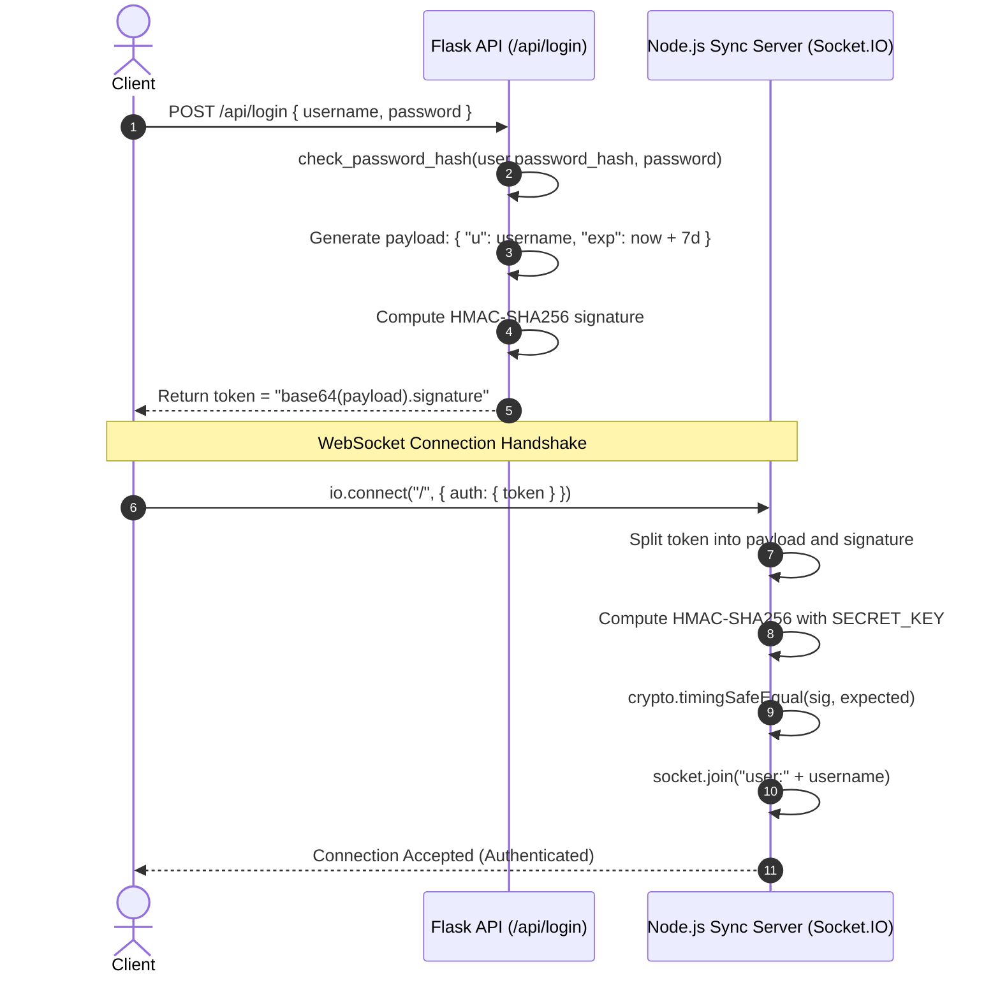
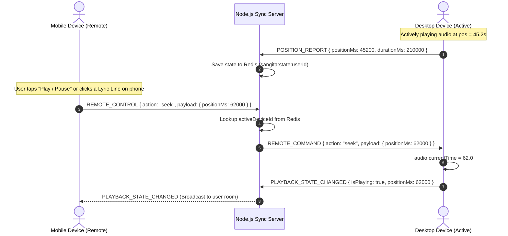
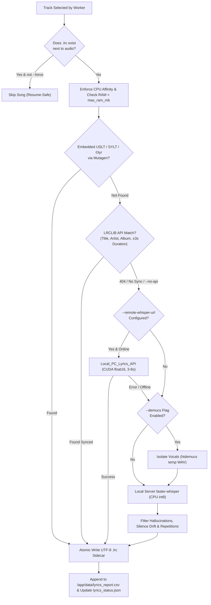
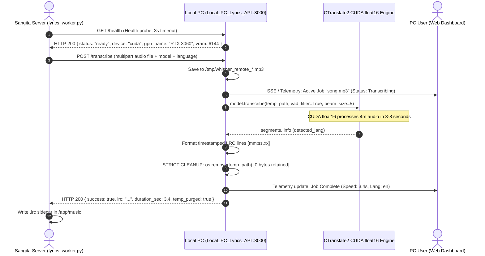

# Sangita — Architecture & System Design Document

This document details the complete end-to-end architectural, engineering, and UI/UX design specifications for **Sangita**, a self-hosted, multi-device music streaming, synced lyrics, and telemetry platform.

---

## 1. High-Level System Architecture

Sangita is architected as a lightweight, distributed, micro-service topology operating entirely within Docker. It uses an Nginx gateway to route traffic between a Python Flask media API server, a Background Lyrics Generation Worker, a Node.js Socket.IO synchronization engine, and backing storage instances (Redis and SQLite).

```mermaid
graph TD
    Client["Client Browser / Phone / PC"] -->|Port 5000:80| Nginx["Nginx Reverse Proxy (Gateway)"]
    
    subgraph Services ["Docker Network: sangita-network"]
        Nginx -->|/api/* & /*| Flask["Flask API & Media Server (:5000)"]
        Nginx -->|/socket.io/*| Sync["Node.js Sync Server (:3001)"]
        
        Flask -->|Metadata & Stats| SQLite[("SQLite (stats.db)")]
        Flask -->|User Accounts| JSONFile[("users.json")]
        Flask -->|Audio & .lrc Sidecars| MusicDir[("/app/music Volume")]
        Flask -->|Spawn / Stop / Monitor| Worker["lyrics_worker.py (psutil CPU/RAM Capped)"]
        
        Worker -->|Read Audio & Write .lrc| MusicDir
        Worker -->|Write Audit Log & Status| DataDir[("/app/data/lyrics_report.csv & lyrics_status.json")]
        
        Sync -->|Pub/Sub & Sessions| Redis[("Redis 7 / Memory Fallback (:6379)")]
    end
    
    Worker -.->|Optional GPU Offload (:8000)| LocalPC["Local_PC_Lyrics_API (NVIDIA CUDA float16)"]
    Cloudflare["Cloudflare Edge"] -.->|Optional Tunnel| Nginx
```

### Component Network Roles & Port Bindings

| Service | Internal Port | Host Port | Role & Responsibility |
| :--- | :--- | :--- | :--- |
| `sangita-proxy` | `80` | `5000` | Nginx gateway; WebSocket upgrades, path-based routing. |
| `sangita-backend` | `5000` | — | Flask + Gunicorn WSGI; audio/lyrics streaming, REST APIs, SQLite stats, worker control. |
| `sangita-sync-server` | `3001` | — | Node.js + Socket.IO; real-time session tracking, remote RPC. |
| `sangita-redis` | `6379` | — | Redis with AOF persistence; device sets and shared playback states. |
| `sangita-tunnel` | — | — | Cloudflare `cloudflared` daemon providing zero-trust public ingress. |
| `Local_PC_Lyrics_API` | `8000` | `8000` | Standalone local PC microservice & dashboard; GPU-accelerated Whisper transcription with ephemeral audio deletion. |

---

## 2. Protocol & Communication Flows

### 2.1 Cryptographic Token Authentication Flow
Both the Flask API server and the Node.js synchronization engine share a synchronized symmetric encryption secret (`SECRET_KEY`). Neither service requires database lookups to validate session authenticity.



---

### 2.2 Audio Streaming & Conditional Range Request Pipeline
Audio files are streamed directly from the host filesystem mount (`/app/music`) through Flask's `send_from_directory(conditional=True)`.

1. **Client Audio Request:** The client `<audio>` element requests `/api/stream/<filepath>?token=<token>`.
2. **Access Control Check:** Flask validates the token and evaluates whether the requesting user's account rules allow access to the specified playlist folder (`allowed_playlists: ["*"]` or explicit folder match).
3. **HTTP 206 Partial Content:** Gunicorn handles `Range: bytes=start-end` headers, allowing the browser to seek instantaneously to arbitrary positions without downloading the entire audio track.

---

### 2.3 Multi-Device State Arbitration & Handover Protocol

Sangita implements a Spotify Connect-style distributed playback model where one device acts as the **Active Player** while all other devices act as **Remote Controllers**.



#### Transit Latency Compensation Formula
When transferring active playback from one device to another (`TRANSFER_PLAYBACK`), transit latency is dynamically offset:
$$P_{\text{corrected}} = P_{\text{reported}} + (\text{Time}_{\text{current}} - \text{Time}_{\text{updatedAt}})$$
This prevents audio "hiccups" or rewinding during device switches.

---

### 2.4 Telemetry & Analytics Aggregation Pipeline

```mermaid
graph LR
    subgraph Client
        Pinger["Client Audio Scrubber"] -->|POST /api/stats/ping (every 10s)| Endpoint["/api/stats/ping"]
    end
    
    subgraph Backend Engine
        Endpoint --> Filter{"Track ID == Last Track<br/>AND elapsed < 120s?"}
        Filter -->|Yes (Continuous)| Merge["UPDATE play_events (duration += 10s)"]
        Filter -->|No (New Song)| Insert["INSERT INTO play_events"]
        
        Merge --> Totals["UPSERT user_totals<br/>UPSERT user_track_totals<br/>UPSERT user_device_totals"]
        Insert --> Totals
        
        Totals --> Trim["DELETE play_events > 1000 per user"]
    end
    
    subgraph Persistence
        Totals --> DB[("SQLite stats.db")]
    end
```

---

### 2.5 Synced Lyrics Waterfall & Resource Control Pipeline

Sangita generates `.lrc` files once per track via an asynchronous, resource-capped worker process (`backend/lyrics_worker.py`) managed from the Admin Dashboard or CLI.



---

## 3. Database & Storage Schemas

### 3.1 SQLite Relational Schema (`stats.db`)

#### Table: `play_events`
Stores granular stream telemetry events. Automatically bounded to 1,000 records per user to conserve storage.
```sql
CREATE TABLE IF NOT EXISTS play_events (
    id INTEGER PRIMARY KEY AUTOINCREMENT,
    username TEXT,
    track_id TEXT,
    playlist TEXT,
    device_id TEXT,
    device_name TEXT,
    device_type TEXT,
    browser TEXT,
    os TEXT,
    timestamp DATETIME DEFAULT CURRENT_TIMESTAMP,
    duration_sec INTEGER
);
```

#### Table: `user_totals`
Aggregates cumulative listening time per user.
```sql
CREATE TABLE IF NOT EXISTS user_totals (
    username TEXT PRIMARY KEY,
    total_seconds INTEGER DEFAULT 0
);
```

#### Table: `user_track_totals`
Maintains per-user, per-song play counts and cumulative durations.
```sql
CREATE TABLE IF NOT EXISTS user_track_totals (
    username TEXT,
    track_id TEXT,
    playlist TEXT,
    total_seconds INTEGER DEFAULT 0,
    play_count INTEGER DEFAULT 0,
    PRIMARY KEY (username, track_id, playlist)
);
```

#### Table: `user_device_totals`
Maintains device-level usage statistics and last seen timestamps.
```sql
CREATE TABLE IF NOT EXISTS user_device_totals (
    username TEXT,
    device_id TEXT,
    device_name TEXT,
    device_type TEXT,
    browser TEXT,
    os TEXT,
    total_seconds INTEGER DEFAULT 0,
    last_seen DATETIME DEFAULT CURRENT_TIMESTAMP,
    PRIMARY KEY (username, device_id)
);
```

#### Table: `track_cache`
Caches file metadata to eliminate repetitive filesystem reads.
```sql
CREATE TABLE IF NOT EXISTS track_cache (
    path TEXT PRIMARY KEY,
    mtime REAL,
    duration REAL,
    title TEXT,
    artist TEXT
);
```

#### Tables: `user_playlists` & `playlist_tracks`
Supports user-created custom virtual playlists and the system "Favorites" list.
```sql
CREATE TABLE IF NOT EXISTS user_playlists (
    id INTEGER PRIMARY KEY AUTOINCREMENT,
    username TEXT NOT NULL,
    name TEXT NOT NULL,
    created_at DATETIME DEFAULT CURRENT_TIMESTAMP,
    UNIQUE (username, name)
);

CREATE TABLE IF NOT EXISTS playlist_tracks (
    id INTEGER PRIMARY KEY AUTOINCREMENT,
    username TEXT NOT NULL,
    playlist_name TEXT NOT NULL,
    track_path TEXT NOT NULL,
    position INTEGER DEFAULT 0,
    added_at DATETIME DEFAULT CURRENT_TIMESTAMP,
    UNIQUE (username, playlist_name, track_path)
);
```

---

### 3.2 Redis Distributed Key Architecture

| Key Pattern | Redis Type | TTL | Purpose |
| :--- | :--- | :--- | :--- |
| `sangita:device:<userId>:<deviceId>` | `String (JSON)` | `30s` | Device metadata lease (name, type, socketId, connectedAt). Refreshed by 25s heartbeats. |
| `sangita:devices:<userId>` | `Set` | None | Set of active device IDs associated with a specific user. |
| `sangita:state:<userId>` | `String (JSON)` | None | Current master playback state: trackId, positionMs, durationMs, isPlaying, volume, loop, shuffle. |

---

### 3.3 File Storage, User Database (`users.json`) & Lyrics Telemetry (`lyrics_report.csv`)

User credentials and authorization rules reside in `data/users.json`:
```json
{
  "admin": {
    "username": "admin",
    "password_hash": "scrypt:32768:8:1$...",
    "role": "admin",
    "rules": {
      "allowed_playlists": ["*"]
    }
  }
}
```

Lyrics generation logs reside in `data/lyrics_report.csv` alongside live worker status in `data/lyrics_status.json`. Each audio track's synced lyrics are saved directly adjacent to the audio file as `<track_filename_without_ext>.lrc` in UTF-8 encoding.

---

## 4. Media Processing & Image Normalization Engine

### 4.1 Automated Canvas & Letterbox Crop Algorithm
Many media files tagged from online video streams (e.g., YouTube) contain 500x500 square canvases with black or white letterbox bars. Sangita executes an automated computer vision trimming pass in `backend/app.py`:

```
Input Image (500x500 with letterbox bars)
          │
          ▼
Compute standard deviation on top 15% & bottom 15% slices
          │
     ┌────┴─────────────────────────────┐
     ▼                                  ▼
stddev < 8 (Uniform Bars)        stddev >= 8 (No solid bars)
     │                                  │
Diff against candidate colors    Diff against 4 corner pixels
(white, black, corners)                 │
     │                                  ▼
     └───────────────────────────► Generate diff mask
                                        │
                                        ▼
                                 bbox = diff.getbbox()
                                 Crop bounding box
                                        │
                                        ▼
                                 Center square crop (1:1 aspect ratio)
                                        │
                                        ▼
                                 Compress JPEG (q=95) / PNG
```

---

## 5. Frontend UI/UX Design System

### 5.1 Color Palette & Theme Tokens
The interface employs a three-tier semantic color palette defined via CSS variables in `frontend/src/index.css`:

| CSS Variable | Dark Mode | Light Mode | Semantic Role |
| :--- | :--- | :--- | :--- |
| `--bg` | `#000000` | `#E4E5F1` | Root canvas background |
| `--surface` | `#0C0C0E` | `#D2D3DB` | Container / Sidebar background |
| `--card` | `#18181B` | `#D2D3DB` | Elevated interactive cards |
| `--card-hover` | `#27272A` | `#C4C5CF` | Hover state background |
| `--border` | `rgba(255, 255, 255, 0.1)` | `rgba(0, 0, 0, 0.08)` | Subdued dividing lines |
| `--emerald` | `#34D399` | `#059669` | Primary brand accent & playback green |
| `--text` | `#FFFFFF` | `#18181B` | High-contrast body typography |
| `--text-sub` | `#A1A1AA` | `#4B4C53` | Secondary metadata labels |

### 5.2 3-Column Layout Architecture & Center-Stage Lyrics Overlay

```
┌─────────────────┬───────────────────────────────────────────┬──────────────────┐
│  SIDEBAR        │  MAIN SCROLL REGION                       │  NOW PLAYING     │
│  (Collapsible)  │                                           │  PANEL           │
│                 │  ┌─────────────────────────────────────┐  │                  │
│  • Brand Logo   │  │ Header (Home, Search, Devices, User)│  │  • Large Cover   │
│  • Library Nav  │  └─────────────────────────────────────┘  │    Visual        │
│  • Filter Chips │  ┌─────────────────────────────────────┐  │  • Track Title   │
│  • Playlists &  │  │ DEFAULT: Hero Banner + Tracklist    │  │  • Format Pill   │
│    Artists      │  │                                     │  │  • Audio Metrics │
│                 │  │ OVERLAY (When Lyrics Toggle Active):│  │  • Sync Status   │
│                 │  │ LyricsView.jsx (Synced .LRC Lines,  │  │                  │
│                 │  │ Auto-scroll, Click-to-Seek)         │  │                  │
│                 │  └─────────────────────────────────────┘  │                  │
├─────────────────┴───────────────────────────────────────────┴──────────────────┤
│  PERSISTENT PLAYER CONTROLS (Play, Seek, Volume, Device, Lyrics, Now Playing)  │
└────────────────────────────────────────────────────────────────────────────────┘
```

When the user clicks the **Lyrics Toggle Button** (located immediately next to the Now Playing View toggle button in `Player.jsx`), the middle region (`MAIN SCROLL REGION`) overlays/switches to `LyricsView.jsx`. Clicking the button a second time restores the previous playlist or dashboard view.

---

## 6. Security & Hardening Specifications

1. **Path Traversal Shielding:** All filesystem lookups for audio (`/api/stream/<path>`), artwork (`/api/cover/<path>`), and lyrics (`/api/lyrics/<path>`) utilize `os.path.normpath` combined with validation checks:
   ```python
   safe = os.path.normpath(urllib.parse.unquote(filepath))
   if safe.startswith("..") or safe.startswith("/"):
       abort(403)
   ```
2. **Cryptographic Timings:** Token signatures are compared using `hmac.compare_digest` in Python and `crypto.timingSafeEqual` in Node.js to eliminate side-channel timing attacks.
3. **Password Hashing:** Passwords are never stored in plaintext; they are hashed with `werkzeug.security.generate_password_hash` using modern scrypt salts.
4. **Isolated Socket Broadcasts:** Synchronization packets are restricted to rooms prefixed by user ID (`user:${userId}`), guaranteeing zero cross-tenant leakage on shared multi-user installations.

---

## 7. Automated Synced Lyrics Engine & Dual-Mode Orchestration Architecture

Sangita implements an automated, resource-capped lyrics transcription and retrieval pipeline that generates time-aligned `.lrc` files:

```mermaid
graph TD
    Trigger["Admin UI / CLI Request"] --> Worker["lyrics_worker.py"]
    Worker --> CheckLRC{"Existing .lrc file?"}
    CheckLRC -- Yes & No --force --> Skip["Skip (Cached)"]
    CheckLRC -- No / --force --> Embedded{"Embedded ID3 / MP4 tags?"}
    
    Embedded -- Synced tags found --> WriteLRC["Write UTF-8 .lrc"]
    Embedded -- No synced tags --> APICheck{"API Mode Enabled?"}
    
    APICheck -- API: ON --> LRCLIB["Query LRCLIB API"]
    LRCLIB -- Found --> WriteLRC
    LRCLIB -- Not found / Error --> RemoteCheck{"Remote GPU Configured?"}
    
    APICheck -- API: OFF --> RemoteCheck
    
    RemoteCheck -- Yes & Online --> LocalPC["Local_PC_Lyrics_API (CUDA float16, 3-8s)"]
    LocalPC -- Transcribed --> WriteLRC
    LocalPC -- Offline / Failed --> ExclusiveCheck{"Exclusive GPU Mode (--only-remote-gpu)?"}
    ExclusiveCheck -- Yes --> SkipCPU["Skip CPU Whisper (Preserve Server Resources)"] --> StatusUpdate
    ExclusiveCheck -- No --> FallbackLog["Log Fallback to CPU Whisper"] --> Whisper["Transcribe with Server CPU Whisper"]
    RemoteCheck -- No --> Whisper
    
    Whisper -- Transcribed --> WriteLRC
    WriteLRC --> StatusUpdate["Update lyrics_status.json & lyrics_report.csv"]
```

### 7.1 Waterfall Retrieval Stages
1. **Cache Layer**: Instant bypass for tracks that already possess valid `.lrc` sidecars (unless `--force` is toggled).
2. **Embedded Metadata**: Mutagen reads ID3 `SYLT`/`USLT`, MP4 `\xa9lyr`, and Vorbis tags.
3. **Online Database (LRCLIB)**: If API mode is ON (`--api`), fetches timestamped lyrics using sanitized title and artist parameters.
4. **Vocal Stem Separation (Optional Demucs)**: Isolates vocals into `vocals.wav` using HTDemucs.
5. **Remote GPU Whisper Offload (`Local_PC_Lyrics_API`)**: If `--remote-whisper-url` is specified and healthy, offloads transcription to a local GPU PC running CTranslate2 `float16`. Purges temp audio immediately after completion.
6. **Exclusive GPU Safeguard (`--only-remote-gpu`)**: When active, if the remote GPU is offline or fails, server CPU Whisper is skipped entirely to ensure 0% heavy CPU/RAM utilization on low-spec servers.
7. **Local Machine Whisper Transcription (CTranslate2 `int8`)**: Runs CTranslate2 quantized Whisper models locally on CPU with VAD filtering and hallucination suppressions if remote GPU is not configured and exclusive mode is off.

### 7.2 Dual Engine & Exclusive GPU Specification
- **API: ON**:
  - Primary: Online LRCLIB database.
  - Secondary (Automatic Fallback): Remote GPU node or local CTranslate2 Whisper model if LRCLIB returns 404 or lacks synced lyrics.
- **API: OFF**:
  - Primary: Direct local machine or Remote GPU Whisper transcription. Bypasses all outbound HTTP requests to external databases.
- **Exclusive GPU Mode (`only_remote_gpu: true`)**:
  - Strictly requires Remote GPU for AI transcription. Completely disables local server CPU Whisper to prevent server CPU/RAM exhaustion.

---

### 7.3 Standalone Local PC GPU Acceleration Architecture (`Local_PC_Lyrics_API`)

For setups where the main Sangita server runs on low-spec hardware (VPS, Docker, Raspberry Pi), the repository includes a standalone microservice in `Local_PC_Lyrics_API/` designed to run on the user's local PC/laptop.



#### Key Technical Invariants of `Local_PC_Lyrics_API`:
1. **Zero Disk Retention Guarantee:** Audio is written to a named temporary file solely for CTranslate2 ingestion and deleted unconditionally in a `finally` block before response dispatch.
2. **Dynamic GPU Auto-Detection:** Queries CTranslate2 device counts and `nvidia-smi` to auto-select `cuda:float16` on NVIDIA GPUs or graceful fallback to CPU `int8`.
3. **Live Hardware Telemetry Dashboard:** Standalone single-page web UI at `http://localhost:8000` reporting live GPU VRAM %, host CPU %, system RAM %, active job progress, and an interactive lyrics history modal.
4. **Network Flexibility:** Operates over local LAN (`http://192.168.x.x:8000`) or encrypted mesh networks like Tailscale (`http://100.x.y.z:8000`) with zero router port forwarding required.

---

## 8. Security Architecture & Threat Mitigation

### 8.1 Brute-Force & Credential Stuffing Defense
Sangita implements an automated, database-backed lockout system (`login_lockouts` table in `stats.db`):
- **Lockout Key:** Indexed by client IP address and requested username (`ip:username`).
- **Threshold:** If failed password attempts exceed 3 within a sliding window, the account/IP is locked out for **300 seconds (5 minutes)**.
- **Response:** Returns HTTP 429 Too Many Requests with informative JSON detailing remaining lockout seconds.
- **Reset:** Automatically clears failure counters on successful authentication.

### 8.2 Private Storefront Boundary & Security Headers
- **Access Warning Banner:** Prominent `h1` warning banner on the authentication gateway explicitly alerting unauthorized visitors to exit.
- **Security Headers Middleware:** Hardened headers applied across all Flask responses:
  - `X-Content-Type-Options: nosniff` (MIME sniffing prevention)
  - `X-Frame-Options: SAMEORIGIN` (Clickjacking prevention)
  - `Referrer-Policy: strict-origin-when-cross-origin`
  - `Cache-Control: public, max-age=86400` on immutable static audio chunks.
- **CORS Restrictions:** Restricts cross-origin requests to explicit client domains or origin matches.

---

## 9. Full-Stack Performance & Optimization Architecture

### 9.1 Database Performance & Concurrency Model
- **SQLite WAL Mode:** `PRAGMA journal_mode=WAL` decouples concurrent readers from writers, eliminating lock contention from the 10-second stats pinger.
- **Memory Cache & Synchronous Pragmas:** `PRAGMA synchronous=NORMAL` and `PRAGMA cache_size=-8000` allocate an 8MB in-memory page cache for fast analytics.
- **Composite B-Tree Indexes:**
  - `idx_play_events_user_ts (username, timestamp DESC)`: Accelerates time-series and range queries.
  - `idx_play_events_user_device (username, device_id, id DESC)`: Accelerates device listening analytics.
  - `idx_user_track_totals_user (username, total_seconds DESC)`: Accelerates leaderboard sorting.
  - `idx_playlist_tracks_user_playlist (username, playlist_name)`: Accelerates custom playlist lookups.
- **Per-Request Connection Pooling (`_RequestDbProxy`):** Reuses a single SQLite connection throughout each Flask request lifecycle via Flask `g`, with clean disposal inside `@app.teardown_appcontext`.

### 9.2 In-Memory Caching & Hoisted Imports
- **Users Cache (`_users_cache`):** Caches parsed user dictionaries in RAM; checks filesystem `mtime` to refresh only upon write operations, eliminating 2+ disk reads per HTTP request.
- **Track Durations Cache (`_durations_cache`):** Caches library duration calculations with a 60-second TTL to avoid costly disk walks.
- **Import Hoisting:** Heavy packages (`mutagen`, `psutil`, `requests`, `PIL`) are imported once at module load, avoiding repetitive `sys.modules` lookups inside route handlers.

### 9.3 Frontend Code-Splitting & Render Optimization
- **Vite Rollup Chunking:**
  - `vendor` chunk (`react`, `react-dom`): 140 kB, long-term cached.
  - `sync` chunk (`socket.io-client`): 41 kB, isolated networking code.
  - `AdminDashboard` lazy chunk: 128 kB, loaded solely when navigating to `/admin` via `React.lazy()` and `<Suspense>`.
  - Main Application JS: **114 kB**, ensuring instantaneous initial paint on mobile devices.
- **Component Memoization (`React.memo`):** Leaf components (`TrackList`, `Sidebar`, `Player`, `Hero`, `Header`, `RightPanel`) are wrapped in `React.memo` and bound to stable `useCallback` references, eliminating unnecessary re-renders.
- **Guarded RAF Animation:** Progress ticks only trigger React state updates when time delta exceeds 50ms, duration changes exceed 100ms, or playing status toggles.

### 9.4 Real-time Sync Server Optimization
- **Concurrent Redis Fetching:** `getDevices()` uses `Promise.all()` to retrieve active device payloads in parallel rather than serial roundtrips.
- **Playback Scrub Throttling:** Non-critical scrub and position changes are throttled to 10 broadcasts/sec (100ms window), preventing WebSocket connection saturation during user seeking.

---

## 10. Enhanced Synced Lyrics UI Specifications

### 10.1 Presentation States & Responsive Modes
- **Standard Center-Stage Mode:** Clean lyrics container framed within the main library content pane.
- **Edge-to-Edge Fullscreen Mode:** Maximizes lyrics into an immersive viewport experience (`position: fixed; inset: 0`), ideal for living-room display or dedicated playback screens.
- **Ambient Canvas Animation:** High-performance HTML5 Canvas / CSS undulating color mesh reflecting the active song palette. Toggleable via UI button with preference stored in `localStorage`.
- **Navigation Minimization:** Automatically dismisses lyrics view when user selects a different playlist or artist in the sidebar, preventing navigation clashes while preserving audio continuity.